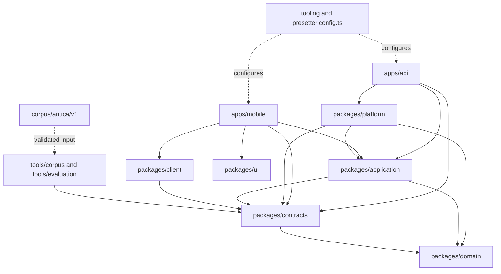

# Architecture

Antica is a layered pnpm monorepo for a private antiques collection: an Expo/React Native mobile app calls a Hono API, application services coordinate owner-scoped transactions, and platform adapters supply PostgreSQL, media, retrieval and model execution. This overview describes the first-trial source at `d134063e`; it separates current behavior from planned hosted work. Architectural decisions and their rationale live in [docs/architecture-decisions.md](docs/architecture-decisions.md); the screen baseline is [docs/ux-flow.md](docs/ux-flow.md).

## Workspace and dependency direction

`pnpm-workspace.yaml` includes `apps/*`, `packages/*` and `tools/*`. The root `package.json` selects pnpm 11.6.0 and Node.js 24 or newer; `presetter.config.ts` owns generated shared tooling, import restrictions and test projects, while `apps/mobile/presetter.config.ts` preserves Expo's configuration boundary.

```text
apps
  api                    # Hono HTTP composition and worker entry
  mobile                 # Expo Router screens and device adapters
packages
  contracts              # Zod wire contracts and validated operation shapes
  domain                 # Portable collection, evidence and source concepts
  application            # Use cases, ports, transaction and job coordination
  platform               # Server persistence and external-service adapters
  client                 # Contract-validated HTTP transport
  ui                     # Shared React Native controls and visual primitives
tooling                  # Presetter support and local verification runners
tools
  corpus                 # Offline corpus validation, installation and relevance CLI
  evaluation             # Snapshot-bound model and retrieval evaluation CLI
corpus
  antica/v1              # Versioned taxonomy, entries, captured sources and release
```

Arrows below mean **depends on**. Workspace edges come from the corresponding `package.json` files; server/client export boundaries are in `packages/application/package.json` and `packages/platform/package.json`. `tooling` and `corpus` are root directories rather than additional pnpm packages.



Portable domain/contracts/application code does not import platform adapters; the root Presetter import restrictions enforce this direction. Mobile consumes the application client boundary rather than composing server adapters. See `presetter.config.ts`, `packages/application/src/client/index.ts` and the workspace manifests.

## Request path and persistence

1. Thin route files in `apps/mobile/src/app` select feature containers. Providers in `apps/mobile/src/providers` restore the session and interface language; containers use TanStack Query and the transport in `packages/client/src`.
2. `apps/api/src/main.ts` loads repository-root environment configuration, validates adapter/model choices, and calls `composeApplication` in `apps/api/src/composition.ts`. Composition opens persistence and binds use cases to ports and adapters; it does not migrate the database.
3. `apps/api/src/application.ts` mounts Hono routes and authentication. Route modules in `apps/api/src/routes` validate contract input, obtain the authenticated owner and invoke application services; `apps/api/src/http.ts` maps failures to stable HTTP/public error shapes.
4. `packages/platform/src/database/transaction.ts` supplies repositories scoped to that owner in a Prisma transaction and rolls back a failed operation result. Record, job, outbox and command-receipt writes can therefore commit together. `packages/platform/src/database/repositories/runtime.ts` implements job/outbox/idempotency persistence.

Prisma 7.10.1 with `@prisma/adapter-pg` owns PostgreSQL access (`packages/platform/package.json`, `packages/platform/src/database/connection.ts`). `packages/platform/src/database/schema.prisma` defines persisted models; native SQL migrations preserve database-specific indexes, constraints and knowledge search structures. The generated TypeScript client is ignored and generated by the platform install script; it is not authored source. Deploy migrations explicitly with `pnpm --filter @antica/platform db:migrate`; schema and command ownership are configured in `packages/platform/prisma.config.ts` and `packages/platform/package.json`.

Repositories combine typed Prisma operations with parameterized SQL where PostgreSQL-specific behavior is needed. Knowledge domain/search migrations are `packages/platform/src/database/migrations/3_knowledge_domain/migration.sql`, `4_knowledge_search/migration.sql` and `5_knowledge_search_extensions/migration.sql` under the same migrations directory. Do not use the earlier table counts in legacy documentation as an inventory of this expanded knowledge schema.

## Jobs, outbox and workflows

Submitting durable work persists a job and an outbox event; a bounded drain reads a pending snapshot, claims work with a lease and settles or defers it. Application handlers cover media, analysis, research, source ingestion, transcription, record editing and knowledge import (`packages/application/src/jobs/drain.ts`, `apps/api/src/jobs.ts`). Knowledge import has its own measured lease/checkpoint/next-event handling; the common dispatcher delegates that responsibility to the portable import handler rather than double-leasing it.

`pnpm jobs:drain` runs `apps/api/src/main.ts --drain` once and closes its database resources. Serving the HTTP API with the local workflow driver does not itself run a continuous worker. The Inngest driver currently mounts `/api/inngest` and wraps the **same persisted drain** in one function, triggered every minute or by `antica/jobs.drain` (`packages/platform/src/workflow/runtime.ts`, `apps/api/src/main.ts`). Verified LlamaParse callbacks have a separate durable inbox consumed alongside the drain (`apps/api/src/webhook.ts`, `apps/api/src/jobs.ts`).

Planned STG05–STG12 work will move this shared-drain execution toward stateless Inngest job functions and establish hosted execution/recovery evidence; the current execution boundary remains `apps/api/src/jobs.ts` and `packages/platform/src/workflow/runtime.ts`.

### Analysis to explicit adoption

`packages/application/src/analysis/service.ts` accepts explicit analysis requests, binds them to record input versions, reuses matching work where appropriate and guards proposal adoption. The handler freezes retrieved evidence, calls the selected model and validates/persists its output (`packages/application/src/analysis/handler.ts`, `packages/platform/src/ai/output.ts`). Upload and new evidence do not automatically start another analysis; the mobile action is in `apps/mobile/src/features/analysis/hooks/useStartAnalysis.ts` and `features/collection/components/RecordAnalysisStatus.tsx` under the same `src` root.

```mermaid
sequenceDiagram
  actor Collector
  participant Mobile
  participant API
  participant DB as Prisma/PostgreSQL
  participant Worker as Persisted drain
  participant Model as Analysis model
  Collector->>Mobile: Analyse this record
  Mobile->>API: POST /v1/records/:id/analyses
  API->>DB: Bind input snapshot; persist run, job and outbox
  API-->>Mobile: Run identity and status
  Worker->>DB: Claim job and load snapshot
  Worker->>Model: Frozen evidence and configured role
  Model-->>Worker: Structured findings and proposals
  Worker->>DB: Validate and persist result
  Mobile->>API: Read /v1/analyses/:id
  API-->>Mobile: Result with pending proposals
  Collector->>Mobile: Select proposals and apply
  Mobile->>API: POST /v1/analyses/:id/apply
  API->>DB: Check record revision and each selected before-value
  alt Matching revision and selected fields
    API->>DB: Patch selected fields; persist adoption and receipt
    API-->>Mobile: Updated record
  else Stale record or selected field
    API-->>Mobile: REVISION_CONFLICT
  end
```

The exact endpoints are mounted in `apps/api/src/routes/analysis.ts`; the mobile result screen is `apps/mobile/src/features/analysis/containers/AnalysisContainer.tsx`. An old result remains a historical snapshot even after the record gains newer evidence.

## Media upload and restart recovery

`apps/mobile/src/adapters/media-upload.ts` creates/resumes upload sessions, transfers signed parts and completes with a stable request identity. Its upload store retains keys, part progress and completion identity; signed URLs are transient and re-signed after restart. `apps/mobile/src/adapters/upload-journal.ts`, `upload-journal-disk.ts` and `features/capture/local-files.ts` under the same `src` root keep device-local copies and journal state where copying succeeds. A failed local copy is not a promise of restart recovery.

The collection's resume banner offers an explicit Resume action; Discard asks for confirmation and Keep retains the files. `apps/mobile/src/features/capture/containers/UploadResumeContainer.tsx` opens `/capture?recordId=…&resume=1`, where the restored file uploads continue; record-form text is not a general persisted capture draft. Server completion verifies stored bytes before media processing is queued (`packages/application/src/evidence/media.ts`, `packages/platform/src/storage/verify.ts`). Local development storage and S3 adapters live in `packages/platform/src/storage`; image/video processing lives in `packages/platform/src/media`. Originals, canonical views, derived crops and video-frame identity remain distinct (`packages/contracts/src/media.ts`, `packages/domain/src/evidence/anchor.ts`).

## Model roles and edit-draft guardrails

Four independently selected roles are configured and capability-checked: analysis, research, record editing and transcription (`packages/platform/src/ai/config.ts`, `capability.ts` in that directory). Development adapters are deterministic and rejected in production; live adapters require explicit registered selections. Parsing, text retrieval and image retrieval have separate configuration and index identities (`apps/api/src/source-providers.ts`, `apps/api/src/retrieval.ts`, `packages/platform/src/search/index-space.ts`).

Models propose changes; the collector decides before record fields are written. Edit drafts carry a record snapshot, model selection and proposed before/after values. Applying requires the current record revision and draft revision, validates selected proposal identities, permits at most one selected proposal per field and compares each selected field's current value with its recorded before-value (`packages/application/src/voice/edit.ts`). A different field changing does not alone make every proposal stale: callers first refresh the record revision, while the per-field guard still rejects an overwritten target. Confirmed proposals produce adoption history; rejected proposals are recorded as skipped; a reject-only edit-card apply leaves the record revision unchanged. See `packages/application/src/voice/edit.ts`, `packages/platform/src/database/repositories/edit-drafts.ts` and `edit-draft-skips.ts` in that repository directory.

### Record message to edit card to adoption

A record conversation is persisted independently of the collection fields. Sending text or confirmed voice-derived text creates a collector message, edit draft, durable job and idempotency receipt in one transaction (`packages/application/src/record/messages.ts`). The record-editing handler persists an assistant reply and any proposals; an ordinary question can yield a reply without an edit card (`packages/application/src/voice/edit-handler.ts`, `packages/platform/src/ai/model.ts`).

```mermaid
sequenceDiagram
  actor Collector
  participant Mobile
  participant API
  participant DB as Prisma/PostgreSQL
  participant Worker as Record-editing handler
  Collector->>Mobile: Send message and optional explicit knowledge attachments
  Mobile->>API: POST /v1/records/:id/messages
  API->>DB: Persist message, frozen context, draft, job and outbox
  API-->>Mobile: Message and pending draft
  Worker->>DB: Load draft snapshot
  Worker->>Worker: Invoke model and validate reply/proposals/citations
  Worker->>DB: Persist assistant reply and ready draft
  Mobile->>API: Read record messages
  API-->>Mobile: Reply and optional edit card
  Collector->>Mobile: Confirm or reject individual fields
  Note over Mobile,DB: Choices alone do not write record fields
  Collector->>Mobile: Apply decisions
  Mobile->>API: POST /v1/edit-drafts/:id/apply
  API->>DB: Check revisions and selected field before-values
  alt Applicable choices
    API->>DB: Apply confirmed fields; record accepted/skipped decisions
    API-->>Mobile: Updated draft and record
  else Stale choice
    API-->>Mobile: REVISION_CONFLICT; refresh for review
  end
```

Routes are in `apps/api/src/routes/record-messages.ts` and `voice.ts` in the same directory. `apps/mobile/src/features/collection/messages/hooks/useEditCard.ts` retains retry identity, refreshes record/message queries after apply and clears a stale request key. `features/collection/containers/RecordHistoryContainer.tsx` and `features/collection/api/record-history.ts` under the mobile `src` root reopen the originating analysis or message from accepted/skipped history.

## Knowledge, retrieval and citations

- **Corpus v1:** `corpus/antica/v1` stores four-category taxonomy, entries, immutable captured source JSON, image URLs, provisional relevance questions and a hashed release manifest. Original text and translations remain distinct; cited claims are not automatic editorial approval. The executable validator/installer is in `tools/corpus/src/validate.ts` and `install.ts` in that directory; `packages/contracts/src/knowledge-corpus.ts` defines the contract. The corpus README's earlier statement that installation is unavailable predates the implemented installer.
- **Installation and imports:** `packages/application/src/knowledge/corpus-install.ts` and `packages/platform/src/database/repositories/corpus-install.ts` install owner-private unsaved drafts and track release identity. `packages/application/src/knowledge/import.ts`, `import-handler.ts` and `import-fetch.ts` in that directory coordinate resumable imports. The two live import adapters currently composed are Cleveland and the Met (`apps/api/src/knowledge-import.ts`, `apps/api/src/knowledge-import/providers/cleveland/adapter.ts`, `providers/met/adapter.ts` under the same import root); AIC and Wikidata captured corpus payloads do not imply equivalent live importer implementations.
- **Revisions and explicit save:** `packages/contracts/src/knowledge-v2.ts`, `packages/application/src/knowledge/service.ts` and `packages/platform/src/database/repositories/knowledge/v2.ts` distinguish working, saved and immutable historical content, review decisions and revision conflicts. Importing or installing content does not silently save it for the collector.
- **Discovery:** `packages/application/src/knowledge/discovery.ts` and `packages/platform/src/database/repositories/knowledge/search.ts` expose owner-scoped lexical search, topic/facet discovery and related records. Segmented revision search projections, tokenization and PostgreSQL search storage live in `packages/platform/src/database/repositories/knowledge/search-projection.ts`, `packages/platform/src/search/text/tokenizer.ts` and the knowledge search migrations. This local lexical path can run without optional cloud retrieval credentials (`apps/api/src/retrieval.ts`).
- **Frozen evidence:** `packages/application/src/knowledge/evidence.ts` resolves eligible claims and citations into snapshot context. Message attachments explicitly identify selected saved knowledge; related cards alone do not attach evidence (`apps/mobile/src/features/collection/messages/hooks/useKnowledgeAttachments.ts`). Model output validation checks citation references against frozen input (`packages/platform/src/ai/editing.ts`, `output.ts` in that directory).
- **Reading:** `apps/mobile/src/features/knowledge/containers/KnowledgeDetailContainer.tsx` supports saved, working and pinned revision reads. Citation panels show captured source evidence; image references are fetched near the viewport (`features/knowledge/components/CitationPanel.tsx`, `RemoteImageReference.tsx` under the mobile `src` root). Source-page locator identities are separate from transient signed read URLs and from provider chunk IDs (`packages/domain/src/source.ts`, `packages/platform/src/search/llama.ts`).

## Interface language

`apps/mobile/src/i18n/resources.ts` bundles Traditional Chinese and English with i18next/react-i18next. `preferences.ts` in that directory defaults to `zh-Hant` and supports an explicit language or Follow system, falling back to Traditional Chinese for unsupported system languages. `apps/mobile/src/providers/LocaleProvider.tsx` and `apps/mobile/src/adapters/preferences.ts` persist the device-local choice, including across sign-out; `/settings/language` is public so it is usable before login. Interface switching does not translate collector text or source evidence; the knowledge reader selects existing language variants and can fall back to original text (`features/knowledge/components/CitedClaim.tsx` under the mobile `src` root).

## Testing and environments

The root `package.json` separates unit (`pnpm test`), PostgreSQL integration (`pnpm test:int`), tooling checks and builds. `presetter.config.ts` defines shared Vitest unit/integration projects; mobile has Jest native tests and Vitest DOM/story tests (`apps/mobile/package.json`). `apps/mobile/e2e/01-request-code.yaml` through `11-record-related-knowledge.yaml`, driven by `tooling/run-maestro.ts`, cover the bounded emulator journeys described in [the UX baseline](docs/ux-flow.md). Their presence is not proof that every error, conflict, provider or accessibility branch passed on a device.

`.github/workflows/ci.yml` runs install, bootstrap, migrations, lint, typecheck, tests, integration, coverage, build and Android export on Node 24/PostgreSQL 16. Local API settings and external-service requirements are documented in [docs/environment.md](docs/environment.md) and validated by `apps/api/src/configuration.ts`, `packages/platform/src/ai/config.ts`, `packages/platform/src/parsing/config.ts` and `packages/platform/src/workflow/runtime.ts`. Test fixtures use `ANTICA_TEST_DATABASE_URL` and isolated test databases; normal startup does not migrate automatically. The approved trial uses development providers; it does not establish live-provider quality or hosted recovery acceptance. This docs publication runs the frozen install and Markdown formatting check; coverage is not run by collector decision.
