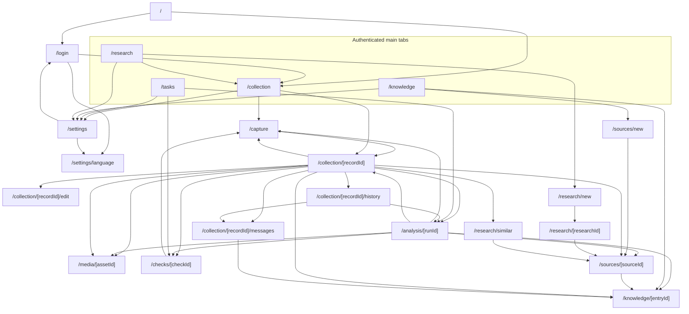

# As-built UX flow

This is the mobile first-trial baseline at `d134063e`, before the UI overhaul. It records implemented routes, controls and recovery states rather than a proposed design. [Architecture](../ARCHITECTURE.md) explains runtime boundaries; the product authority is https://app.notion.com/p/3f7b2572f78881a39becf965abbf9f2a.

The collector reports DEMO01 flows 01–11 passed, with 03/04/05/07 re-run after FIX01 at `d134063e`. These are bounded development-emulator results, not full journey, conflict, live-provider or production acceptance. Flow numbers below refer to files in `apps/mobile/e2e`; “none” means no dedicated Maestro coverage exists for that screen or branch, even where component or integration tests exist.

## Navigation over real routes

Route groups `(private)` and `(tabs)` organize files without appearing in URLs. Each node below is a real route in `apps/mobile/src/app`; dynamic segments use the file names verbatim. Root and private layouts mount navigation rather than additional destinations. Authentication is guarded by `apps/mobile/src/features/auth/containers/SessionNavigator.tsx`, with a restoring-session cover that preserves cold-start deep links.

Source anchors: `apps/mobile/src/app`, `features/navigation/containers/TabNavigator.tsx`, `features/auth/containers/SessionEntryContainer.tsx` and the feature containers cited below, all under `apps/mobile/src`. Native file pickers, the camera overlay and citation panels are states within a route; external source links open through the system rather than a new Expo route. Back navigation returns to the prior stack screen; it is omitted from the diagram for clarity.

## Shared screen states

`apps/mobile/src/components/QueryState.tsx` supplies query loading and retryable read errors: 「載入中…」 (“Loading…”), 「重試」 (“Retry”). Empty copy depends on the feature; the generic text is 「目前沒有資料。」 (“There is no data yet”). Each journey below names specialized states and states that have no dedicated recovery UI. Read-only screens do not have a write-conflict state; that does not imply every request succeeds.

Unless a full path is given, feature paths in this document are relative to `apps/mobile/src`. Quoted zh-Hant strings come from `i18n/locales/zh-Hant.ts`; user-entered and source text retains its original language.

## Journey A — sign in and restore a session

| Screen / route                     | Entry and exit                                                                                                                                                             | Primary and secondary actions                                                                                          | States and recovery                                                                                                                                                                                                                                              | Maestro coverage                                                                                                     |
| ---------------------------------- | -------------------------------------------------------------------------------------------------------------------------------------------------------------------------- | ---------------------------------------------------------------------------------------------------------------------- | ---------------------------------------------------------------------------------------------------------------------------------------------------------------------------------------------------------------------------------------------------------------- | -------------------------------------------------------------------------------------------------------------------- |
| Session entry `/`                  | App launch or public fallback; redirects to `/collection` when authenticated and `/login` otherwise. A restoring deep link keeps its destination behind the session cover. | Wait for restore; then use the selected destination.                                                                   | Loading cover; authentication failure falls back to login. No empty or write-conflict state.                                                                                                                                                                     | 01, 02; reopen in 03 and 06.                                                                                         |
| Welcome and phone `/login`         | Unauthenticated entry; welcome advances to permitted phone entry on the same route.                                                                                        | WhatsApp login, then 「繼續」 (“Continue”); Language opens `/settings/language`.                                       | Empty phone disables Continue; sending/delivery failure and rate-limit feedback preserve the request context.                                                                                                                                                    | 01-request-code.yaml.                                                                                                |
| Code and session recovery `/login` | Successful code request shows the masked destination and delivery status; successful verification replaces the route with `/collection`.                                   | Verify; resend after countdown; change number. Retry session restoration if verification succeeded but restore failed. | 「正在傳送驗證碼…」 (“Sending verification code…”); sent, failed and rate-limited delivery; verifying spinner/duplicate-submit lock; invalid code retains input; expiry retains number and allows resend; session retry stays on login. No record-edit conflict. | 02-authenticate.yaml covers successful sign-in; 01/02 do not exhaust expiry, rate-limit or restore-failure branches. |

Sources: `features/auth/containers/LoginContainer.tsx`, `SessionEntryContainer.tsx`, `SessionNavigator.tsx` in that directory, `features/auth/components/LoginCodeStep.tsx`, and `providers/AuthProvider.tsx`.

## Journey B — capture one item or a complete set

The six capture steps share `/capture`; the in-app camera and label picker are overlays. Creating the single/set draft already creates a record before final media save. An existing record enters through `/capture?recordId=…`; a description action adds `mode=describe`, and a linked action carries its run/action/check context. See `features/capture/containers/CaptureContainer.tsx`, `hooks/useCaptureRecord.ts` and `hooks/useActionLink.ts` under that feature.

| Screen / route                                               | Entry and exit                                                                                                              | Primary and secondary actions                                                                                                                                                  | States and recovery                                                                                                                                                                                                                                           | Maestro coverage                                                                                                                                   |
| ------------------------------------------------------------ | --------------------------------------------------------------------------------------------------------------------------- | ------------------------------------------------------------------------------------------------------------------------------------------------------------------------------ | ------------------------------------------------------------------------------------------------------------------------------------------------------------------------------------------------------------------------------------------------------------- | -------------------------------------------------------------------------------------------------------------------------------------------------- |
| Collection `/collection`                                     | Authenticated landing/tab; open a record or start `/capture`.                                                               | 「新增藏品」 (“Add item”); search, freshness chips, filters, sort, clear and previous/next pages; Settings gear.                                                               | Loading/error/retry; distinct empty collection and no-filter-matches states; resume banner when local files remain. No collection-level conflict editor.                                                                                                      | 02–04; return paths in 05/07–09/11.                                                                                                                |
| Kind, step 1 `/capture`                                      | Add item starts here; choosing single/set advances to media.                                                                | 「單件」 (“Single item”) or 「整套」 (“Complete set”).                                                                                                                         | Busy while creating the record; creation error stays visible and retryable by action. No separate empty list or conflict panel.                                                                                                                               | 03/04 single; 08 set.                                                                                                                              |
| Media, step 2 `/capture`                                     | New record or Add evidence from an existing record.                                                                         | Take photos, import photos, capture/import video; continue to review.                                                                                                          | Camera/library permissions, picker cancellation and acquisition errors; errors leave draft state available.                                                                                                                                                   | 03 gallery, 04 camera; 08/09 multi-shot camera. Video is not established by these flows.                                                           |
| Camera overlay `/capture`                                    | Take-photo action; stays open between shots. Review/last-shot thumbnail opens step 3; Close returns to media.               | Shutter; shot type set/base/mark/detail; flash, switch lens, import and review.                                                                                                | Permission/fallback view, capture busy/error, live shot count; each successful shot joins the draft.                                                                                                                                                          | 04, 08, 09.                                                                                                                                        |
| Review grid, step 3 `/capture`                               | Captured/imported files; Next opens words, Back returns to media.                                                           | Select/exclude tiles; assign whole-set or component labels; add photo/video and retry failed file.                                                                             | Empty/selected counts, thumbnails, failed files. Component labels are not shot types and do not derive a piece count.                                                                                                                                         | 03 grid; 08 six photos and two components; 09 four photos.                                                                                         |
| Words, step 4 `/capture`                                     | Review or linked description action; Continue opens details.                                                                | Type original words or record/import audio, transcribe and 「確認原話」 (“Confirm original words”); prepare description, select proposals, 「採用描述」 (“Adopt description”). | Recording/transcription/job pending, failed or ready; original words require explicit confirmation; edit-draft readiness and apply errors. A linked action must still be valid before supply.                                                                 | 03 typed confirmation; full audio and stale-draft branches have no dedicated Maestro flow.                                                         |
| Details, step 5 `/capture`                                   | Confirmed words or skip onward; Continue opens save.                                                                        | Name, category, height/unit, general/detail location and receipt selection.                                                                                                    | Editable draft and field/acquisition errors; no dedicated conflict chooser at this step. Unsaved form text is not fully restored from upload journals.                                                                                                        | 03/04 name; 08 set.                                                                                                                                |
| Save, step 6 `/capture`                                      | Details, or explicit upload Resume; successful save opens `/collection/[recordId]`.                                         | 「儲存」 (“Save”); per-file retry and retry-all.                                                                                                                               | Local/uploading/uploaded/failed per file, progress and busy/error; completion precedes server processing. Saving/uploading does not auto-run analysis.                                                                                                        | 03 reopen, 04 upload, 08 set, 09 resume.                                                                                                           |
| Resume banner `/collection` → `/capture?recordId=…&resume=1` | App restart finds unfinished owner/device uploads.                                                                          | Resume; Discard opens confirmation; Keep cancels discard.                                                                                                                      | Retained copies/journals; expired signed URLs are renewed. Successful completion removes the prompt. Copy failure means recovery cannot be promised.                                                                                                          | 09-upload-resume.yaml: restart before saving; multipart interruption itself is covered by adapter specs rather than a staged mid-part device kill. |
| Record `/collection/[recordId]`                              | Collection row or capture completion; exits to edit, messages, history, media, checks, related knowledge or analysis.       | Analyse/result action; Add evidence; 「編輯資料」 (“Edit details”); messages and history. Secondary: image search and open references.                                         | Record loading/error/retry; absent observations/checks/references show empty states; per-media loading/uploaded/processing/ready/failed and retry when a local copy remains. Analysis status distinguishes no run, running, result, failure and new evidence. | 03/04/08/09; edit 07, messages/history 05, related 11.                                                                                             |
| Manual editor `/collection/[recordId]/edit`                  | Edit details from record; Cancel/Back returns, asking before discarding dirty edits. Successful Save returns to the record. | Save changed fields; create/select location, edit measurements/units and acquisition details; Cancel.                                                                          | Initial loading/error/retry; validation and saving lock; revision conflict refetches once and automatically retries only if edited fields did not also change. Overlapping changes require a per-field Keep mine / Use current choice before save.            | 07-record-edit.yaml verifies name, height/unit, location, save and reopen; no dedicated conflict Maestro branch.                                   |
| Change history `/collection/[recordId]/history`              | Record history action; an entry opens the originating message or analysis.                                                  | Open source suggestion; load older changes; retry refresh/page.                                                                                                                | Empty history; loading/error/retry; failed older/refresh reads retain already rendered entries. Read-only, so no write conflict.                                                                                                                              | 05-record-messages.yaml covers accepted/skipped history and return to the source message.                                                          |

Sources: `features/collection/containers/CollectionContainer.tsx`, `RecordContainer.tsx`, `RecordEditContainer.tsx`, `RecordHistoryContainer.tsx` in that directory; `features/collection/hooks/useRecordEditSave.ts`; `features/capture/components`, `features/capture/hooks/useCaptureSave.ts`, `features/capture/containers/UploadResumeContainer.tsx`; `adapters/media-upload.ts` and `adapters/upload-journal.ts`.

## Journey C — analyse, inspect evidence and perform checks

| Screen / route                                          | Entry and exit                                                                                  | Primary and secondary actions                                                                                                                                 | States and recovery                                                                                                                                                                                                      | Maestro coverage                                                              |
| ------------------------------------------------------- | ----------------------------------------------------------------------------------------------- | ------------------------------------------------------------------------------------------------------------------------------------------------------------- | ------------------------------------------------------------------------------------------------------------------------------------------------------------------------------------------------------------------------ | ----------------------------------------------------------------------------- |
| Record analysis entry `/collection/[recordId]`          | Saved record or newly supplied evidence; explicit Analyse opens `/analysis/[runId]`.            | 「分析」 (“Analyse”), 「再次分析」 (“Analyse again”) or open existing result; Add evidence.                                                                   | Saved/not analysed, analysing, analysed, failure and 「新證據尚未分析」 (“New evidence not yet analysed”). No automatic analysis after upload or new evidence.                                                           | 03/04 inspect saved state; no dedicated full analysis Maestro journey.        |
| Result `/analysis/[runId]`                              | Analysis request, existing record result, Tasks or adoption history.                            | Select/apply proposed fields; start suggested check; supply/dismiss action; open record. Secondary: add evidence, method, media/observation/source citations. | Loading/error/retry; queued/running, completed/partial/failed; newer-input warning preserves old result. Revision-conflict apply/action errors require refreshed review. Empty groups show only their available content. | None dedicated; source/native and API tests cover bounded behavior.           |
| Linked capture `/capture?recordId=…&runId=…&actionId=…` | Action card asks for photo/video or typed/spoken observation; description mode starts at words. | Capture/confirm supplied evidence; finish description returns to the run.                                                                                     | Action lookup, already supplied/dismissed or invalid action; capture errors. Recording evidence does not automatically change a check result or start a new analysis.                                                    | 03/04 cover generic capture only; linked-action branch has no dedicated flow. |
| Tasks `/tasks`                                          | Main tab; opens `/checks/[checkId]` or `/analysis/[runId]`.                                     | View each check or analysis action; Settings gear.                                                                                                            | Loading/error/retry, empty list and localized progress. No direct task write/conflict dialog.                                                                                                                            | None.                                                                         |
| Check `/checks/[checkId]`                               | Record check list, analysis suggestion or Tasks.                                                | Record 「有」 (“Present”), 「沒有」 (“Absent”) or 「無法判定」 (“Unable to determine,” requires reason); Add evidence opens capture with check ID.            | Loading/error/retry; unrecorded/recorded result, pinned method steps and method-update notice; busy writes and revision errors remain on screen.                                                                         | None.                                                                         |
| Media `/media/[assetId]`                                | Record media, reference or analysis citation; Back returns to origin.                           | View original/canonical evidence, select image region or prepare/use a video frame.                                                                           | Loading/error/retry; busy frame request, job failure/processing, exact prepared-frame time and selected-anchor feedback. No record-field conflict form.                                                                  | 03/04 cover record thumbnails/upload, not full region/video-frame controls.   |

Sources: `features/collection/components/RecordAnalysisStatus.tsx`, `features/analysis/containers/AnalysisContainer.tsx`, `features/analysis/components/ActionCard.tsx`, `features/analysis/action-capture-href.ts`, `features/tasks/containers/TasksContainer.tsx`, `features/checks/containers/CheckContainer.tsx`, `features/media/containers/MediaContainer.tsx`.

## Journey D — import a book or pages and inspect a source

| Screen / route                      | Entry and exit                                                                                                            | Primary and secondary actions                                                                                                                 | States and recovery                                                                                                                                                                      | Maestro coverage                                                     |
| ----------------------------------- | ------------------------------------------------------------------------------------------------------------------------- | --------------------------------------------------------------------------------------------------------------------------------------------- | ---------------------------------------------------------------------------------------------------------------------------------------------------------------------------------------- | -------------------------------------------------------------------- |
| Source intake `/sources/new`        | 「匯入書籍或書頁」 (“Import book or pages”) on Knowledge; successful registration replaces it with `/sources/[sourceId]`. | Pick PDF or page images; title and author/unknown-author; edition/publisher; Save. Secondary: page reorder, printed label, rotate/crop/reset. | Empty file selection or missing title disables Save; per-file uploading/failed states and errors retain selection; successful assets are reused on retry. No dedicated conflict chooser. | None.                                                                |
| Source detail `/sources/[sourceId]` | Intake, analysis/research citation or saved reference; optional `versionId`/`pageId` pins the locator.                    | Inspect pages/raw text and open original PDF; More pages and linked knowledge drafts.                                                         | Loading/error/retry; partial/failed/processing source, page quality/needs-review, no pages, no draft yet; original-read refetch/open errors. Read-only, no overwrite conflict.           | 10/11 open citation panels, not this complete source-intake journey. |

Sources: `features/sources/containers/SourceIntakeContainer.tsx`, `SourceDetailContainer.tsx` in that directory and `features/sources/components/SourcePagePreview.tsx`. Source order, printed page labels and canonical coordinates are distinct; a parser's partial output is shown as partial rather than a finished book.

## Journey E — find comparables and save research

| Screen / route                           | Entry and exit                                                                                                                | Primary and secondary actions                                                                                                               | States and recovery                                                                                                                                                                                                                                 | Maestro coverage |
| ---------------------------------------- | ----------------------------------------------------------------------------------------------------------------------------- | ------------------------------------------------------------------------------------------------------------------------------------------- | --------------------------------------------------------------------------------------------------------------------------------------------------------------------------------------------------------------------------------------------------- | ---------------- |
| Research home `/research`                | Main tab; choose Collection to find an image, or `/research/new`.                                                             | New research; Collection for image search; Settings gear.                                                                                   | Static choice screen; no asynchronous loading/empty/conflict state of its own.                                                                                                                                                                      | None.            |
| Similar images `/research/similar`       | Image search from record photo, with anchor/record/asset/view query parameters; source links open `/sources/[sourceId]`.      | Search reference library or own collection, compare a match and save reference to record. Secondary: region/whole-image selection and note. | Image loading, search/compare busy, empty results, partial scope/provider warnings and action errors. Changing scope/anchor clears the comparison; save carries the expected record revision and reports failure without a dedicated merge chooser. | None.            |
| New research `/research/new`             | Research home; optional record/entry context supported by the route. Successful start replaces with `/research/[researchId]`. | Type question and Start research; curated-only vs curated-plus-web scope; named-author preference.                                          | Blank question/busy disables start; request errors retain question. No write-conflict chooser.                                                                                                                                                      | None.            |
| Research detail `/research/[researchId]` | Started run; source citations open pinned source pages or external URLs.                                                      | Edit generated note title/paragraphs and Save note; inspect cited sources and existing saved notes.                                         | Loading/error/retry; queued/running/waiting polling, provider warnings, no sources and draft absent; save uses expected draft revision and reports errors on the page.                                                                              | None.            |

Sources: `features/research/containers/ResearchContainer.tsx`, `NewResearchContainer.tsx`, `ResearchDetailContainer.tsx` in that directory; `features/search/containers/SimilarSearchContainer.tsx`; route files in `apps/mobile/src/app/(private)/research`. Source/collector text remains in its original language; UI language does not imply translation of research evidence.

## Journey F — interface language and account settings

| Screen / route                | Entry and exit                                                                              | Primary and secondary actions                                                            | States and recovery                                                                                                                                                                                                      | Maestro coverage                                                                                                |
| ----------------------------- | ------------------------------------------------------------------------------------------- | ---------------------------------------------------------------------------------------- | ------------------------------------------------------------------------------------------------------------------------------------------------------------------------------------------------------------------------ | --------------------------------------------------------------------------------------------------------------- |
| Settings `/settings`          | Gear on any main tab; Language opens `/settings/language`, Sign out replaces with `/login`. | Language; Sign out.                                                                      | Current device preference/resolved language and masked phone; read-failed preference retry. Local sign-out proceeds even if ending the remote session fails. No conflict or empty-content form.                          | 06-language-settings.yaml.                                                                                      |
| Language `/settings/language` | Login or Settings; Cancel/Done returns to prior route, or `/` when directly linked.         | Choose 「繁體中文」 (“Traditional Chinese”), English or Follow system; preview and Save. | Loading/default fallback; unchanged Save disabled; saving locks choices and Back; read/write failure retries; successful saved feedback. Cancel retains prior choice. This preference survives app restart and sign-out. | 06 covers language selection, preview/save/cancel and persistence; it does not exhaust device storage failures. |

Sources: `features/settings/containers/SettingsContainer.tsx`, `LanguageSettingsContainer.tsx` in that directory, `features/settings/hooks/useLanguageSettings.ts`, `i18n/preferences.ts`, `providers/LocaleProvider.tsx`. The bundled interface has only `zh-Hant` and `en`; Follow system maps Chinese to Traditional Chinese and unsupported languages to that same fallback.

## Record messages and edit cards

Everything below stays on `/collection/[recordId]/messages`; the record summary is the entry point, and history can deep-link with `messageId`/`editDraftId` to focus the source reply. Back returns to the record/history stack.

| Screen state                           | Primary and secondary actions                                                                                                                              | Loading, empty, error and conflict behavior                                                                                                                                                                                                                                                                                      | Maestro coverage                                                                                                                                    |
| -------------------------------------- | ---------------------------------------------------------------------------------------------------------------------------------------------------------- | -------------------------------------------------------------------------------------------------------------------------------------------------------------------------------------------------------------------------------------------------------------------------------------------------------------------------------- | --------------------------------------------------------------------------------------------------------------------------------------------------- |
| Conversation and composer              | Type and 「傳送」 (“Send”); record voice, stop/transcribe and inspect text before sending. Load earlier messages; open a cited source/entry.               | Loading/retry and empty invitation; pending/thinking/still-working/failed reply states. Retry can restore failed text without silently sending it. Voice has recording/transcribing/ready/failed states. Text entry remains above the keyboard.                                                                                  | 05-record-messages.yaml covers typed question/reply, then edit request; complete voice behavior has no dedicated flow.                              |
| Related-knowledge tray and attachments | Open related entry; explicitly attach/remove claim evidence before Send.                                                                                   | Related loading/error/empty state is separate from thread/composer; cards do not attach automatically. Attachments clear after successful send and retain frozen claim identity.                                                                                                                                                 | 11-record-related-knowledge.yaml covers open, attach, remove, reattach, send and cited reply.                                                       |
| Assistant reply and optional edit card | Read reply; for each proposed field choose 「確認」 (“Confirm”) or 「不採用」 (“Do not apply”), then 「套用決定 ({{count}})」 (“Apply decisions (count)”). | A question may have no edit card. Choices alone do not write. Apply waits for a decision/current record, disables while running and records accepted/skipped rows. Stale apply refreshes latest content and shows a conflict message for renewed review; unrelated field changes do not automatically invalidate every proposal. | 05 confirms name, rejects period, applies only name, checks history and opens the source message. Conflict retry is not a dedicated Maestro branch. |
| Cited reply and citation panel         | Open knowledge citation; inspect captured evidence and Close.                                                                                              | Frozen citation identity is preserved; unavailable content/read errors remain recoverable. The panel restores trigger focus when closed.                                                                                                                                                                                         | 11 opens a genuinely cited development reply; 10 opens an entry claim citation.                                                                     |

Sources: `features/collection/messages/containers/RecordMessagesContainer.tsx`, `EditCardContainer.tsx` in that directory; `features/collection/messages/hooks/useRecordMessageThread.ts`, `useMessageComposer.ts`, `useEditCard.ts`, `useKnowledgeAttachments.ts` in that directory; `features/collection/messages/components/KnowledgeEvidenceCard.tsx`. Server guardrails are in `packages/application/src/voice/edit.ts` and `packages/application/src/record/messages.ts` from the repository root.

## Knowledge browse, reading and review

| Screen / route                          | Entry and exit                                                                                             | Primary and secondary actions                                                                                                                                             | States and recovery                                                                                                                                                                                                       | Maestro coverage                                                                                                        |
| --------------------------------------- | ---------------------------------------------------------------------------------------------------------- | ------------------------------------------------------------------------------------------------------------------------------------------------------------------------- | ------------------------------------------------------------------------------------------------------------------------------------------------------------------------------------------------------------------------- | ----------------------------------------------------------------------------------------------------------------------- |
| Knowledge `/knowledge`                  | Main tab; opens `/knowledge/[entryId]?view=saved` or `view=working`, or source intake.                     | Search, choose saved/draft, browse category/topic, show/clear facet filters; open result. Secondary: import book and Settings.                                            | Loading/error/retry; separate no saved content/no matches; failed next-page retry retains existing rows; there is no dedicated expired-cursor reset control. Returning from detail preserves mounted search/filter state. | 10-knowledge.yaml browses category/topic/material, clears filters, searches 斗彩/Doucai and returns with state intact.  |
| Entry reading `/knowledge/[entryId]`    | Browse result or source draft; related cards use pinned `view=revision&revision=…` for historical reading. | Read claims, 「原文」 (“Original”) / 「譯文」 (“Translation”), open citation and image/source reference. Secondary: Edit details and review/save for nonhistorical views. | Loading/error/retry; saved/draft/editorial-review status; language fallback and missing-image states. Historical revision view hides editing/save. A requested revision is not silently replaced by the current one.      | 10 covers detail, citation, language switch, image/source and back; 11 verifies related entry opens without the editor. |
| Review/editor on `/knowledge/[entryId]` | Explicit Edit details on saved/working view; Save is a separate explicit review action.                    | Edit title/summary; review and save; reload working revision after conflict.                                                                                              | Busy blocks duplicate save; failure retains typed content; conflict disables Save until explicit reload/review; success feedback. No automatic collector save on import or browse.                                        | No dedicated save/conflict Maestro branch; 10 is primarily reading.                                                     |
| Citation panel within entry/messages    | Claim or assistant citation trigger; Close returns to reader/composer.                                     | Inspect quotation/structured source evidence and source link; Close.                                                                                                      | Modal content, unavailable evidence and external-open failure; original source text can differ from interface language. No record write/conflict state.                                                                   | 10 and 11.                                                                                                              |

Sources: `features/knowledge/containers/KnowledgeContainer.tsx`, `KnowledgeDetailContainer.tsx`, `RelatedKnowledgeContainer.tsx` in that directory; `features/knowledge/hooks/useKnowledgeSearch.ts`, `useKnowledgeEntry.ts` in that directory; `features/knowledge/components/KnowledgeReading.tsx`, `CitedClaim.tsx`, `KnowledgeEditor.tsx`, `CitationPanel.tsx`, `RemoteImageReference.tsx` in that directory. A Translation selection chooses an existing variant; it does not request a new translation, so missing translations can still display English source text with fallback information.

## Known UX problems (to fix)

The following collector list is the input to the UI overhaul, preserved verbatim. It records observations of the trial; the current docs do not resolve them.

- O1: the record page is a stack of five full-width buttons.
- O2: internal field names and IDs are shown.
- O3: the citation title overlaps the status bar, and UUIDs and paths are shown.
- O4: topics are plain text.
- O5: the original/translation switch is two full-width buttons, and the translation still shows English.
- O6: capture is a card inside a card.
- UI0: "lacks images, taste and design; the knowledge base looks empty, show knowledge".
